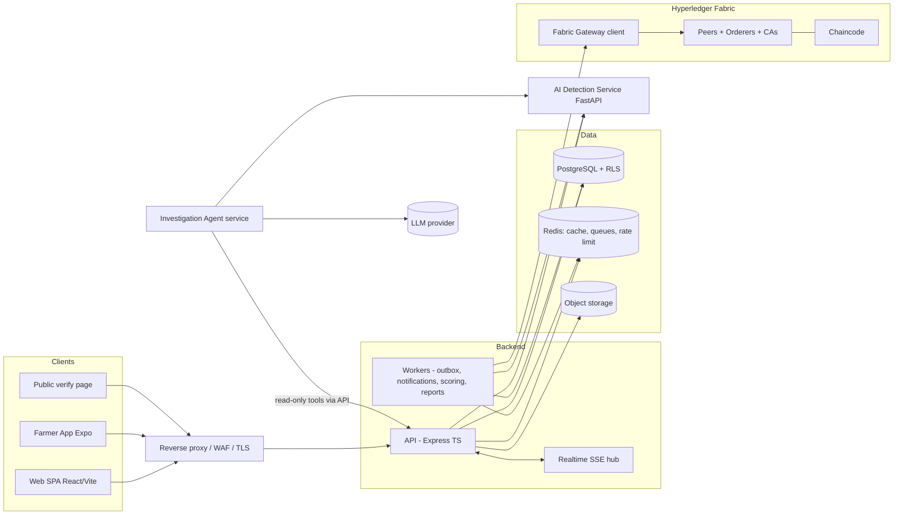

# SmartSeed — System Architecture (Phase 1)

## 1. Style and key decisions

| Decision | Choice | Reason |
|---|---|---|
| Repo layout | Monorepo (npm workspaces) | Shared types/Zod schemas across web, mobile, backend |
| Backend | Modular monolith (Express+TS) + separate worker process | Independent scaling of API vs workers without microservice sprawl |
| Blockchain | Separate service boundary (`fabric-gateway` module + chaincode) | Isolated failure domain, own scaling |
| AI | Separate FastAPI service, HTTP/JSON contract | Python stack, independent scaling |
| Async | Postgres transactional outbox + Redis/BullMQ queues | Atomic DB+chain intent; retries; idempotency |
| Realtime | Server-Sent Events (SSE) first, WebSocket if bidirectional needed | Simpler through proxies; sufficient for alerts |
| Tenancy | Shared schema + `tenant_id` + Postgres RLS | Scales to many tenants; enforced below app layer |
| Storage | S3-compatible (MinIO local) | Documents, QR assets |

Unnecessary technologies avoided: no Kafka (BullMQ/outbox suffices at this scale), no separate microservice per domain, no GraphQL.

## 2. Component diagram



## 3. Backend module layout (`apps/api/src/modules`)
`auth`, `tenants`, `subscriptions`, `users-rbac`, `organizations`, `products`, `batches`, `inventory`, `shipments`, `transfers`, `qr`, `passport`, `verification`, `blockchain` (outbox + gateway adapter), `risk`, `alerts`, `investigations`, `notifications`, `audit`, `reports`, `platform-admin`.
Each module: `routes → controller (Zod validation) → service (business rules) → repository (parameterized SQL)`. Cross-module calls go through service interfaces only. Central error handler maps domain errors to the `{ data, meta, error }` envelope.

## 4. Transaction lifecycle (transfer example)
```mermaid
sequenceDiagram
  participant U as User
  participant A as API
  participant D as Postgres
  participant W as Outbox worker
  participant F as Fabric
  U->>A: POST /v1/transfers (Idempotency-Key)
  A->>A: authN, authZ, tenant ctx
  A->>D: BEGIN; lock batch holding row; validate owner, qty, expiry
  A->>D: insert transfer(PENDING_CHAIN), inventory hold, outbox row, audit; COMMIT
  A-->>U: 202 {transferId, chainStatus: PENDING}
  W->>D: claim outbox row (SKIP LOCKED)
  W->>F: sign (org identity in HSM/KMS-backed wallet) + submit, wait commit
  F-->>W: txId + commit status
  W->>D: chainStatus=COMMITTED, txId; state transition; audit; enqueue notifications
  W-->>U: SSE event
```
Failure handling: submit is idempotent via deterministic `eventId` (chaincode rejects duplicates); worker retries with backoff; on endorsement-policy failure → `FAILED`, hold released, alert raised. A reconciler queries the chain by `eventId` for rows stuck in `SUBMITTED`.

## 5. Scan and risk pipeline
1. `GET /v1/public/verify/{token}` → validates token, loads passport, checks chain-commit status, **records scan** (async insert via queue to keep latency low), returns the four-part status.
2. Scan event → `scan.recorded` job → feature builder (windowed counts in Redis, geo from coarse location) → AI service `/v1/score` (rules + IF + stats) → risk engine combines → `risk_scores` history + `anomaly_predictions` → alert if threshold crossed (deduped) → investigation agent queued for High/Critical.
3. Risk engine: signals normalized to [0,1], grouped into correlation families (e.g. *scan-behaviour*: frequency, burst, dormant-spike; *geo*: distance, impossible-travel; *chain-integrity*; *inventory*; *expiry*; *actor-history*; *ML*). Family score = max within family (prevents double counting); final = 100 × Σ(wᶠ·sᶠ) / Σwᶠ with an override floor (e.g. confirmed revocation or failed chain verification ⇒ ≥ 75). Weights live in `risk_config` (versioned, per-tenant overridable within platform bounds).

## 6. AI service contract (summary)
`POST /v1/score` → `{ riskScore, category, severity, indicators[], confidence, evidence[], recommendedAction, modelVersion, mode: "rules+unsupervised"|"hybrid-supervised" }`. Versioned models registered in `model_versions`; every response persisted. Drift metrics (feature PSI) computed by scheduled job.

## 7. Investigation agent
Stateless service with a fixed tool set (read-only REST calls into the API under a service identity limited by scope): `get_scan_history`, `get_chain_history`, `get_batch`, `get_ownership_history`, `get_indicators`. Orchestration loop produces a JSON report validated against a schema; each claim references `recordId`s fetched in-session; unsupported claims are rejected. Provider-agnostic LLM interface; prompt-injection hardening: retrieved text is data, tools are read-only, output is never executed.

## 8. Environments and deployment
- **Local:** Docker Compose (api, worker, web, ai, agent, postgres, redis, minio, fabric test-network containers, mailhog).
- **Test/CI:** ephemeral Compose; Fabric chaincode tested with mock stub unit tests plus a network integration job.
- **Staging/Prod:** containers on Kubernetes (or ECS) — stateless tiers HPA-scaled; managed Postgres (PITR), managed Redis; Fabric peers on dedicated nodes. Config per env via env vars/secret manager; no secrets in repo.
- **Observability:** pino JSON logs with correlation IDs, Prometheus metrics, OpenTelemetry traces, Grafana/Loki; health `/healthz` (liveness) and `/readyz` (deps).

## 9. Repository layout
```
apps/ web/ api/ worker/ mobile/
services/ ai/ agent/
chaincode/ smartseed-cc/
packages/ shared-types/ ui/ config/
infra/ docker/ k8s/ fabric/ github-workflows/
docs/
```
