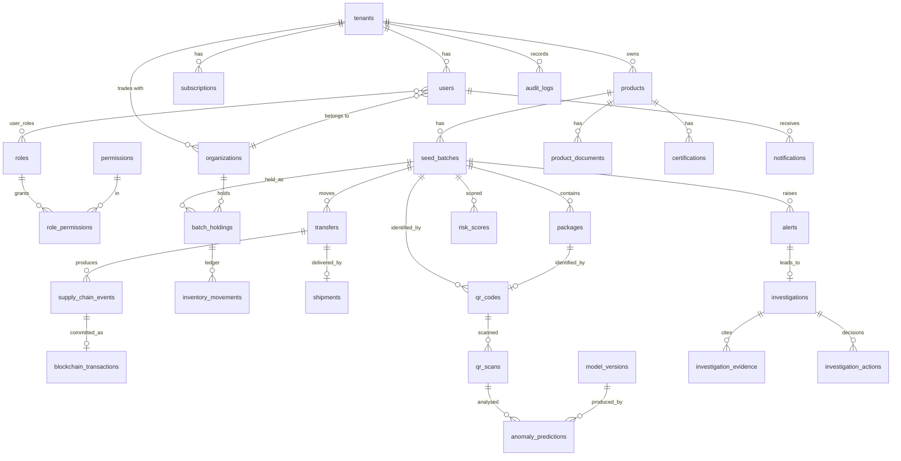

# SmartSeed — Database Design (Phase 1)

PostgreSQL 16, UUID primary keys (`gen_random_uuid()`, v4; v7 can be adopted on PG 18), `timestamptz` everywhere, `numeric(18,3)` for quantities, `jsonb` only for flexible metadata. Migrations: `node-pg-migrate` (SQL files, forward + down). Money stored as integer minor units + currency.

## 1. Tenant isolation
- Every tenant-owned table has `tenant_id uuid NOT NULL REFERENCES tenants`.
- RLS enabled and **forced**; policy: `tenant_id = current_setting('app.tenant_id')::uuid` (plus a controlled `app.is_platform` bypass for platform admin / auditor read paths with separate policies).
- The API connects as a non-owner role without `BYPASSRLS`; each request runs `SET LOCAL app.tenant_id` inside its transaction.
- Downstream orgs (distributor etc.) see rows through `batch_holdings` / `shipments` policies keyed on their `org_id`, not on tenant.
- Composite FKs `(tenant_id, id)` prevent cross-tenant references.

## 2. ER overview

## 3. Tables (columns abbreviated: PK `id`, `created_at`, `updated_at` implied)

**Identity / platform**
- `tenants(name, slug UNIQUE, status ENUM[pending,active,suspended], plan_id, region)`
- `organizations(type ENUM[manufacturer,distributor,wholesaler,retailer,authority], legal_name, registration_no, fabric_msp_id, fabric_identity_ref, status)`; `tenant_organizations(tenant_id, org_id, relationship, status)`; type-specific detail tables `manufacturers, distributors, wholesalers, retailers` (1:1 on `org_id`: license nos., facilities, addresses).
- `users(tenant_id NULL for platform/auditor, org_id, email UNIQUE(lower), password_hash, mfa_secret_enc, mfa_enabled, status, last_login_at)`; `roles(name, scope)`, `permissions(code)`, `role_permissions`, `user_roles`.
- `refresh_tokens(user_id, family_id, token_hash, expires_at, used_at, revoked_at)`.
- `farmers(device_id_hash UNIQUE, phone_hash NULL, language, region_code)` — pseudonymous, minimal PII.

**Catalogue / inventory**
- `products(tenant_id, name, brand, crop_type, variety, category, description, packaging jsonb, regulatory_ids jsonb)`; UNIQUE(tenant_id, brand, name, variety).
- `certifications(product_id|batch_id, type, issuer, number, valid_from, valid_to, document_id)`; `product_documents(owner_type, owner_id, object_key, sha256, mime, size)`.
- `seed_batches(tenant_id, product_id, batch_code UNIQUE(tenant_id, batch_code), mfg_date, expiry_date CHECK(expiry>mfg), location, facility, initial_qty CHECK>0, unit, status ENUM, record_hash)`.
- `packages(batch_id, serial_no UNIQUE(batch_id, serial_no), status)` — created lazily/in ranges for package-level QR.
- `batch_holdings(batch_id, org_id, quantity CHECK(quantity >= 0), reserved CHECK(reserved >= 0 AND reserved <= quantity), version)` UNIQUE(batch_id, org_id) — row-locked for transfers.
- `inventory_movements(holding_id, delta, reason ENUM, ref_type, ref_id, balance_after, idempotency_key UNIQUE, created_at)` — append-only (no UPDATE/DELETE grants; trigger enforced).

**Supply chain**
- `transfers(batch_id, from_org, to_org, quantity CHECK>0, status, idempotency_key UNIQUE, requested_by, chain_status)`.
- `shipments(transfer_id, status ENUM[created,dispatched,in_transit,received,rejected,cancelled], under_investigation bool, carrier, dispatched_at, received_at, source_location, dest_location, received_qty)`.
- `supply_chain_events(batch_id, event_type, sequence UNIQUE(batch_id, sequence), actor_org, counterparty_org, qty, occurred_at, corrects_event_id NULL, payload jsonb, record_hash)` — append-only.
- `blockchain_transactions(event_id UNIQUE, chain_event_id UNIQUE, status ENUM[pending,submitted,committed,failed], fabric_tx_id, block_number, validation_code, attempts, last_error, submitted_at, committed_at)` (acts as the transactional outbox).

**QR / scans**
- `qr_codes(tenant_id, batch_id, package_id NULL, public_token UNIQUE (hashed storage: token_hash), kind, status ENUM[active,revoked,superseded], issued_at, revoked_at, revoke_reason, supersedes_id)`.
- `qr_scans(qr_id, scanned_at, ip_hash, geo_lat_round, geo_lon_round, country, region, device_hash, farmer_id NULL, result, chain_verified bool)` — partitioned monthly by `scanned_at`; indexes `(qr_id, scanned_at DESC)`.

**Risk / investigation**
- `risk_config(version, weights jsonb, thresholds jsonb, active)`; `model_versions(name, version, kind, trained_at, data_description, metrics jsonb NULL, status)`.
- `anomaly_predictions(subject_type, subject_id, model_version_id, risk, category, severity, confidence, indicators jsonb, evidence jsonb, created_at)`.
- `risk_scores(batch_id, score 0..100 CHECK, level, components jsonb, config_version, computed_at)`.
- `alerts(tenant_id, batch_id, type, severity, risk_score, dedupe_key UNIQUE WHERE status<>'closed', status, assignee_id, detected_at, resolution jsonb)`.
- `investigations(alert_id, status, report jsonb, report_schema_version, requires_human_review bool, agent_run_id)`; `investigation_evidence(investigation_id, record_type, record_id, kind ENUM[observed_fact,model_interpretation,hypothesis], summary)`; `investigation_actions(investigation_id, action ENUM[...7], actor_id, note, at)`.

**Operations**
- `notifications(user_id, type, channel, dedupe_key UNIQUE, payload, read_at, sent_at)`; `notification_preferences(user_id, type, channel, enabled)`; `push_tokens`.
- `plans(code, limits jsonb, price_minor, currency, interval, active)`; `subscriptions(tenant_id, plan_id, status, trial_ends_at, renews_at, gateway_ref)`; `usage_counters(tenant_id, metric, period, value)`; `invoices(...)`.
- `audit_logs(tenant_id, actor_id, action, entity_type, entity_id, ip, before_hash, after_hash, prev_hash, entry_hash, at)` — hash-chained, insert-only.

## 4. Indexing principles
FK columns, `(tenant_id, created_at DESC)` for list endpoints (cursor pagination on `(created_at, id)`), partial indexes for open alerts and pending outbox rows, GIN only where jsonb filtering is proven needed.

## 5. Integrity rules enforced in DB
CHECK constraints (non-negative balances, expiry > manufacture), append-only triggers on movements/events/audit, unique idempotency keys, deferred FK between events and transactions, `REVOKE UPDATE, DELETE` for the app role on append-only tables.
